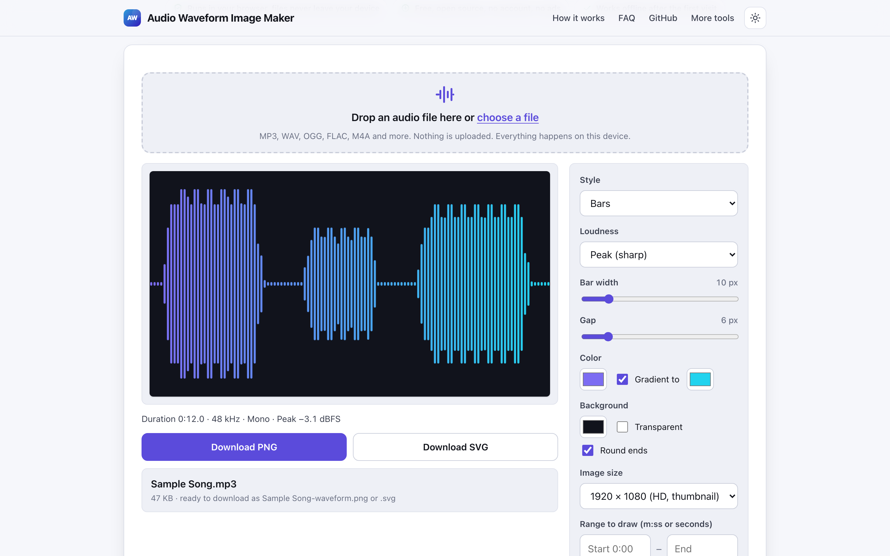
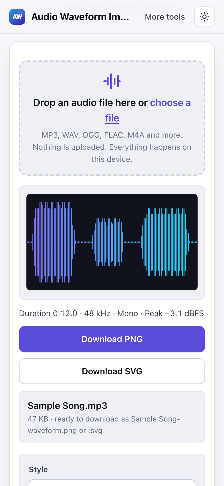

# Audio Waveform Image Maker

> Turn any audio file into a waveform picture as PNG or SVG in your browser, with no watermark.

**🌐 Use it now: [turhe123.github.io/audio-waveform-image-maker](https://turhe123.github.io/audio-waveform-image-maker/)** · free · open source · runs in your browser · works offline

  

## Why

This is a free, open-source alternative to the audio waveform visualizers in Kapwing and Veed, which put a watermark on free exports, require an account, upload your audio to the cloud and have paid plans from about 16 USD per month. Here your files never leave the device, there is no account, no ads and no limits, it works offline and it can be installed as an app.

## Screenshots

<p align="center"></p>

<p align="center"><em>Audio Waveform Image Maker in the browser, light theme</em></p>

<p align="center"></p>

<p align="center"><em>Audio Waveform Image Maker on a phone</em></p>

## Features

- Draws the waveform of one local audio file, decoded with the browser's WebAudio `decodeAudioData`. Stereo and multichannel files are mixed down, mono is drawn the same way.
- Three styles: Bars (default), Mirrored lines and Outline.
- Loudness mode: Peak (sharp) or RMS (softer), normalized to the loudest peak.
- Bar width (1 to 60 px) and gap (0 to 40 px) sliders, plus an optional "Round ends" switch.
- One color or a two-color gradient.
- Background color or a transparent background (the preview shows a checkerboard).
- Image size presets: 1080 × 1080, 1920 × 1080, 1500 × 500, or a custom size up to 4000 px per side.
- Optional range to draw, set by start and end time (`m:ss` or seconds).
- Info line with duration, sample rate, channel layout and peak level (dBFS), so it doubles as a simple waveform viewer.
- Export as PNG (drawn at the exact chosen size) or SVG (`rect` and `path` shapes with the same colors). Files are named after the audio file, for example `my-song-waveform.png`. Unicode file names are kept.
- Live preview that redraws as you change options; pressing Enter in the options downloads the PNG.
- Empty state shows a sample waveform; silent files draw a flat line and say so.
- Files longer than ten minutes are analysed in a Web Worker with a progress bar; a memory warning appears for very long recordings (about one hour of stereo audio).
- Large PNGs are clamped to a safe pixel count when the browser limits canvas size (stated in a message). SVG has no such limit.
- Decoding problems and non-audio files show an inline error message.
- Light and dark themes, responsive down to phone width, installable as a PWA.

**Input formats:** anything your browser can decode, typically MP3, WAV, OGG, Opus, FLAC, and in most browsers M4A, AAC and WebM audio. Only one file is drawn at a time.

**Output formats:** PNG and SVG. No text overlays and no video output.

**Limits:** image sides are limited to 16 to 4000 px; the whole file is decoded in memory, so very long files need a lot of RAM.

## How to use

1. Drop an audio file on the page or choose one. The waveform and the info line appear.
2. Pick a style, bar width and gap, colors and background (or transparent).
3. Choose an image size, and optionally a start and end time to draw only part of the track.
4. Click **Download PNG** or **Download SVG**.

## Privacy

- Nothing is uploaded. Your audio is read and processed in your browser only.
- No cookies and no account.
- Page views are counted anonymously with [GoatCounter](https://www.goatcounter.com/), which is cookieless and open source.
- After the first visit a service worker caches the page, so it works offline.

## Run it locally

```sh
git clone https://github.com/turhe123/audio-waveform-image-maker
cd audio-waveform-image-maker
python3 -m http.server 4173
```

Then open http://127.0.0.1:4173/. There is no build step.

## Tests

```sh
npm i -D @playwright/test && npx playwright install chromium
npx playwright test
```

## Third-party code

None: browser APIs only.

## Built with AI

Audio Waveform Image Maker was written by [Claude Code](https://claude.com/claude-code) inside an automated pipeline, from a plain-English spec. No code or assets from any commercial product were used; it is a clean-room implementation of a feature set, not a copy.

What that means in practice:

- The full source is in this repo under the MIT license. Read it before you trust it with your files.
- Everything runs in your browser. It makes no network requests except an anonymous, cookieless page-view count (GoatCounter); your files never leave the device.
- The page is tested headless in Chromium (Playwright) before every release, but it has had less human review than hand-written software. Bug reports and pull requests are welcome.

## Support ❤️

If this saved you a subscription, you can support the project on [Ko-fi](https://ko-fi.com/leodavidai).

## More free web tools

Find more at [turhe123.github.io/web-tools](https://turhe123.github.io/web-tools/).

## License

MIT © Or Davidai Bachar
